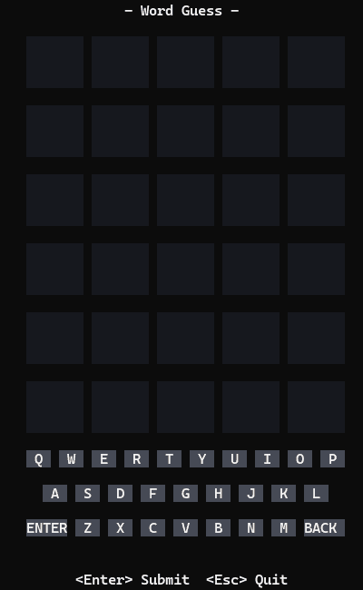
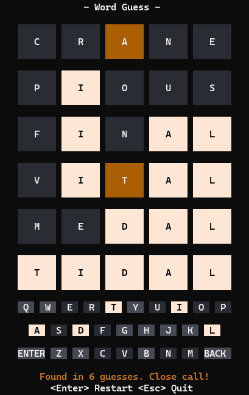

# Word Guess TUI

[](https://github.com/lvocanson/word_guess_tui/actions/workflows/ci.yml)

Word Guess in the terminal: full-screen board, on-screen keyboard, mouse or keyboard input, and an 11,694-word dictionary — in a **26 KB** binary built on one dependency (`crossterm`) with no runtime files.

**[Play it in the browser](https://lvocanson.github.io/word_guess_tui/)** — the same game compiled to WebAssembly, in a single self-contained page.

<p align="center">
  
</p>

```bash
cargo run --release      # no prerequisites, 119 KB
./wgt-ship.sh run        # everything on, 26 KB — toolchain and flags handled for you
```

Rust stable builds and runs with no prerequisites.
Windows and Linux are the tested targets.

## Playing

Six guesses at a hidden five-letter word.
A submitted guess must be in the dictionary; each letter comes back **white** (right letter, right place), **orange** (right letter, elsewhere) or **dark grey** (absent), and the on-screen keyboard keeps the best score seen for every letter.

| Input | Action |
|-------|--------|
| `a`–`z` | type into the current row |
| `Backspace` | delete the last letter |
| `Enter` | submit the guess — or start a new game once won/lost |
| `Esc`, `Ctrl-C` | quit |
| Left click | press the on-screen key, or the `ENTER` / `BACK` button |

The layout adapts to the terminal: as height becomes available, features switch on in priority order — board, message line, keyboard, controls line, row gaps, full-height cells, title.
It still plays in a terminal only 5 columns by 6 rows.

<p align="center">
  
</p>

The game runs on the alternate screen and restores the terminal on exit (and on a panic, in the profiles that keep the panic hook).

## Build-time configuration

Both knobs are read by the build script and baked into generated constants; changing one triggers a rebuild of the compressed corpus.

| Variable | Default | Effect |
|----------|---------|--------|
| `WGT_WORD_LEN` | `5` | Word length: only the words of that length in `res/answer_words.txt` and `res/valid_words.txt` are compressed |
| `WGT_MAX_GUESSES` | `6` | Number of guesses per game |

```bash
WGT_WORD_LEN=6 WGT_MAX_GUESSES=8 cargo build --release
```

```powershell
$env:WGT_WORD_LEN = '6'; $env:WGT_MAX_GUESSES = '8'; cargo build --release
```

## Word data

Both source lists are generated from the [English Speller Database](https://wordlist.aspell.net) (ESDB) by `tools/fetch_words.sh`: the answers are its common US-spelling words, the accepted guesses everything it lets through across US, British, Canadian and Australian spellings.
Each list keeps ESDB's licence notice next to it, in `res/*.LICENSE.txt`.

At the default length, that is 2,011 answers plus 9,683 further accepted guesses, 11,694 words total, merged and compressed at build time into a single arithmetic-coded stream: **11,614 bytes, 0.99 B per word**, including the bit that says which words are answers.
No word exists in the binary as text; lookups (`is_valid`, `pick_target`) decode the stream on the fly.
See [OPTIMIZATION.md](OPTIMIZATION.md) for the encoding's design and its measurements.

## Repository layout

| Path | Contents |
|------|----------|
| `src/main.rs` | terminal setup, event loop, panic hook |
| `src/app.rs` | controller: draft input, messages, chrome |
| `src/game.rs` | rules: target, guesses, scoring, phase |
| `src/ui.rs` | layout, grid model, hit-testing, raw-ANSI renderer |
| `src/words.rs` | word database over the embedded corpus |
| `src/codec.rs` | range decoder and the model math both ends share |
| `build/` | build script: compresses `res/` into `corpus.bin` + `constants.rs` |
| `build/codec_enc.rs` | the encoder-only half of the codec, kept out of the binary |
| `res/` | source word lists (every length) and their ESDB licence notices |
| `docs/` | the README's demo GIFs |
| `tools/fetch_words.sh` | regenerates the word lists in `res/` from ESDB |
| `tools/stats.rs` | compression and binary-size reporter (`cargo run --example stats`) |
| `tools/validate.sh` | one-shot tests + Windows/Linux builds + size report |
| `wgt-ship.sh` | one-command shipping build, prerequisites installed on demand |
| `vendor/crossterm/` | patched crossterm 0.29.0 (see its `LOCAL_PATCH.md`) |

## Tests

```bash
cargo test
```

Covers the rules, the word database, and `corpus_round_trips` — the guard that the shipped corpus decodes bit-exactly to the words the build encoded.

## Binary size

Size is the project's main constraint; the whole record lives in [OPTIMIZATION.md](OPTIMIZATION.md).

| Profile | Windows | Linux (glibc) |
|---------|--------:|--------------:|
| First working TUI (baseline) | 396,288 | — |
| Stable, no prerequisites | 121,344 | 327,248 |
| `ship`, pinned nightly | **26,112** | 65,208 |

Bytes on disk — the size a release asset shows. OPTIMIZATION.md compares un-padded section totals instead, which differ from these by the linker's section padding (and, on musl, by zero-initialized data).

## Documentation

- **[BUILD.md](BUILD.md)** — the build command for every profile on every platform.
- **[OPTIMIZATION.md](OPTIMIZATION.md)** — measured size changelog, measurement method, what is still stuck.
- **[vendor/crossterm/LOCAL_PATCH.md](vendor/crossterm/LOCAL_PATCH.md)** — what the vendored crossterm changes, and why.

## License

[MIT](LICENSE).

The vendored crossterm in `vendor/crossterm/` is MIT too, © 2019 Timon — its own [LICENSE](vendor/crossterm/LICENSE) applies to that subtree and is kept alongside it.
